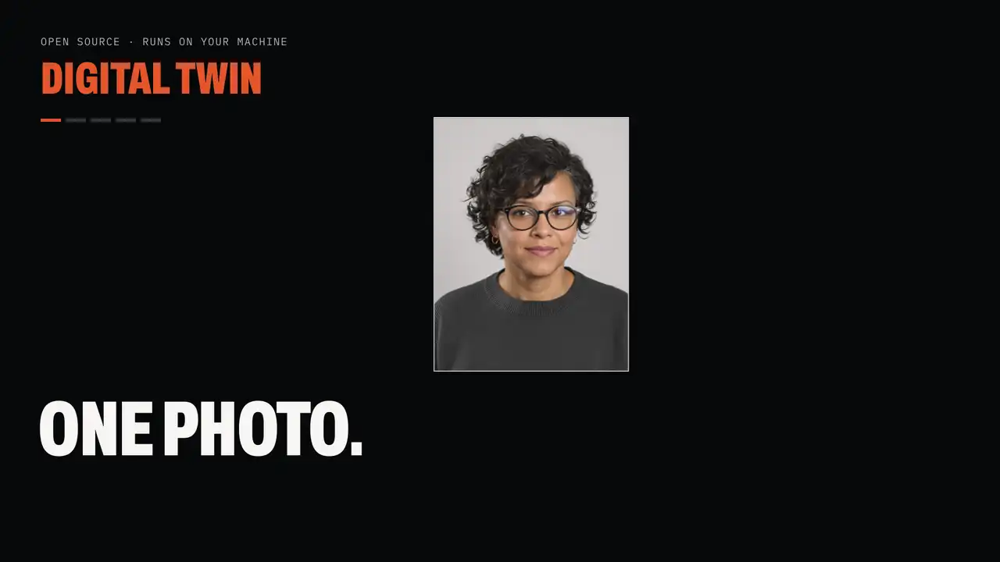
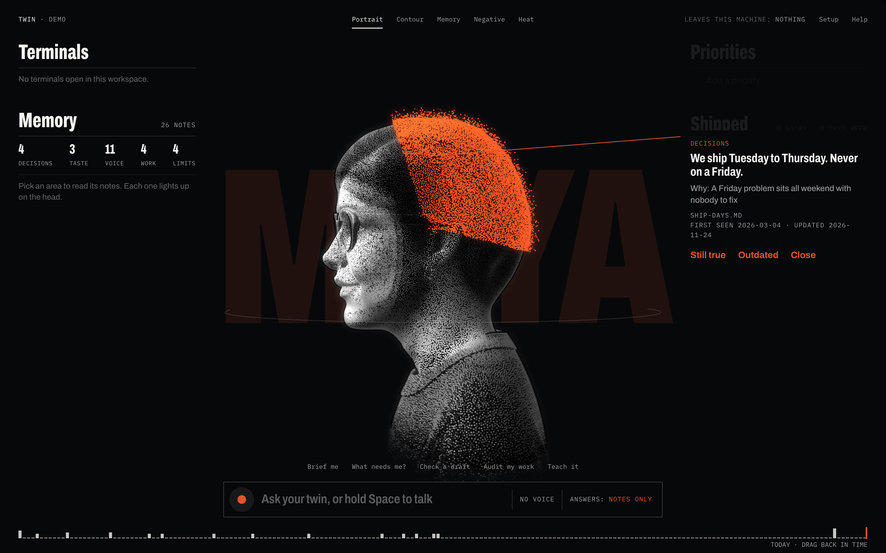
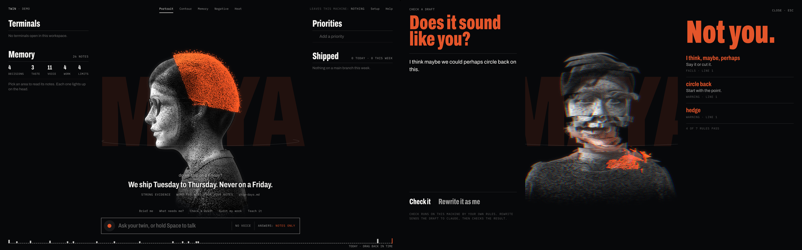
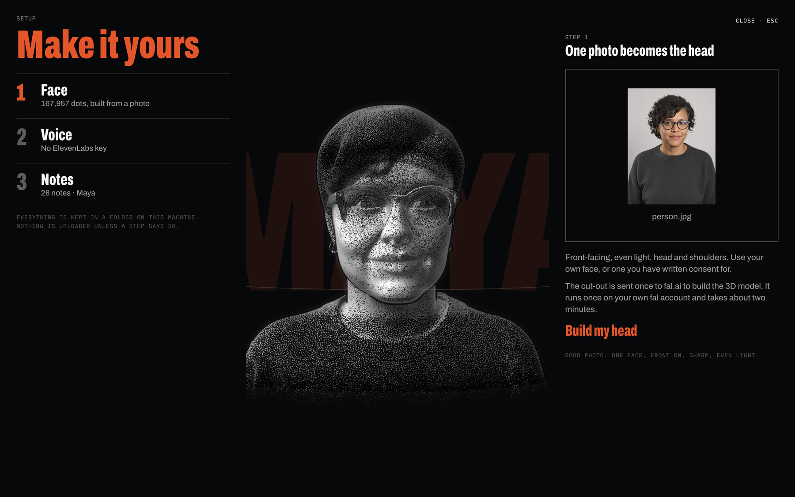
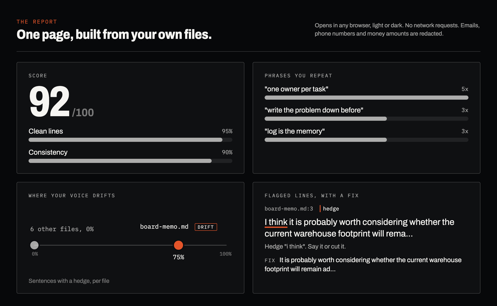

<p align="center"><a href="https://whystrohm.com/twin"></a></p>

<h3 align="center">A digital twin that knows your work.</h3>

<p align="center">Your decisions, voice rules and limits, in one place your coding sessions can ask.<br>
Build it from one photo, your own voice, your notes and the repos you pick.<br>
It runs on your machine, with Claude Code or any tool that speaks MCP, and your own keys.</p>

<p align="center"><strong>English</strong> · <a href="README.zh-CN.md">简体中文</a></p>

<p align="center">
  <a href="https://github.com/whystrohm/digital-twin-of-yourself/actions/workflows/test.yml"></a>
  <a href="https://github.com/whystrohm/digital-twin-of-yourself/releases"></a>
  <a href="LICENSE"></a>
  <a href="https://github.com/whystrohm/digital-twin-of-yourself"></a>
</p>

<p align="center">
  <a href="https://whystrohm.com/twin?utm_source=github&utm_medium=repo&utm_campaign=twin-4"><strong>Full tour</strong></a> ·
  <a href="#try-it-in-one-minute">Try it</a> ·
  <a href="#make-it-yours">Make it yours</a> ·
  <a href="#connect-your-coding-sessions">Claude Code</a> ·
  <a href="#what-leaves-your-machine">What leaves your machine</a> ·
  <a href="docs/TWIN.md">Guide</a>
</p>

<p align="center"><strong>New in 4.0:</strong> the twin app, a head built from your photo, a voice,<br>and an MCP server for your coding sessions. Free and open source. <a href="https://github.com/whystrohm/digital-twin-of-yourself/releases">Get it</a></p>

<p align="center"><em>The person in the demo is made up: a generated face and made-up notes. The repo counts and the answer about what shipped are examples.</em></p>

## What it does

AI tools are fast and they do not know you. You correct the same thing in every session, drafts come back in a generic voice, and agents act without asking. The twin gives your decisions one home that every session can read.

- **Looks like you.** Drop one photo. You get a 3D head made of dots that you can turn all the way round.
- **Sounds like you.** Record a minute and clone your voice on your own ElevenLabs account. The twin reads your own decisions back to you in your own voice. It is a little eerie the first time. It is also the fastest way to hear whether a line sounds like you.
- **Knows what you decided.** Every dot is one note: a decision, a taste, a voice rule or a limit, with its reason and its date. Hover the head and you are looking at how you work, written down.
- **Reads your code.** List your repos and it reads their instruction files and proposes the rules it finds. You see what your coding tools have been told about you, and what they have not.
- **Answers with the source.** Ask it what you decided and it shows the note it came from.
- **Checks drafts in your voice.** Paste a draft and it names each line that fails your rules.
- **Stops at your limits.** It reports matching limits and asks for your yes on restricted actions it recognizes. It gives advice. It cannot stop another tool from acting.
- **Built for agents.** It is an MCP server, so Claude Code can ask it before it guesses and propose a note when you correct it. A session cannot accept its own proposal.
- **Stays on your machine.** Notes are plain Markdown files. With the default settings nothing leaves your computer.

## How it works




*The demo twin you get on first run. Maya is made up: a generated face and made-up notes.*

## Build your own clone

The demo is a made-up person. The point is to make yours and see what comes out.

Your own writing is the strongest source there is. Nobody else's examples tell a model how you sound. The [voice tools](docs/VOICE-TOOLS.md) in this repo measure how you write and turn it into rules a checker can run, so drafts, posts and marketing copy come back in your language and not a generic one.

Play with it. Ask it what you decided last month. Paste in a draft and watch it fail. Change your mind and watch the old note get replaced. Use your own face and voice, or ones you have written consent for.

## Why

| The problem | What the twin does |
|---|---|
| Your corrections do not carry. You fix it in one session and fix it again in the next tool. | Keeps each decision as a plain file with its source and date. Any session that speaks MCP can ask for it. |
| Instruction files drift. Nobody knows which rule is current or where it came from. | A new decision can replace an old one. The old one is kept, marked replaced, and can be restored. |
| AI drafts do not sound like you. | Checks drafts up to 60,000 characters against your rules and names each line that fails. |
| Agents act without asking. | Reports matching limits and asks for your yes on restricted actions it recognizes. It gives advice. It cannot stop another tool from acting. |
| You run more sessions than you can watch. | Shows what shipped and what is next, and your open sessions if you turn that on. |

## Does it work

One saved sample run of the learning loop, with fresh sessions each time: a session does not know something, you correct it, the next session uses the note, you change the decision, and the following session gives the updated answer. The transcript and recorded checks are in [validation/LOOP_RESULTS.md](validation/LOOP_RESULTS.md). `python3 validation/twin_loop.py` runs the sample again through your own Claude account and can incur usage charges.

That is one run on made-up notes. It shows the loop works. It is not a measure of how much time it saves you.

## Try it in one minute

The twin app requires macOS or Linux with Python 3.9 or newer and POSIX file-access support. It does not support native Windows. Linux and WSL were not verified in this release audit. The demo needs no extra packages or account. Cloning contacts GitHub. The typed demo then runs offline with the default settings.

```bash
git clone https://github.com/whystrohm/digital-twin-of-yourself.git
cd digital-twin-of-yourself
python3 twin/twin.py
```

It opens the demo twin in your browser. Then:

- Hover the head. Every dot belongs to one note.
- Type `do we ship on a Friday?` and it answers from the notes and shows which one.
- Type `send the supplier email` and it stops and asks for a yes.
- Click **Check a draft** and paste something with "I think maybe" in it. It checks against the example rules until you set your own in Setup.
- Drag the bar at the bottom back in time.



## Make it yours

Click **Setup**. Three steps, each optional.

| Step | What happens | Needs |
|---|---|---|
| **Face** | Drop one photo. It checks the photo and says what to fix, then builds a 3D head you can turn all the way round. | A fal key and a few Python packages. One paid build on your own account. |
| **Voice** | Pick the free system voice, an ElevenLabs voice, or record a minute and clone your own. | Nothing for the system voice. An ElevenLabs key for the rest. |
| **Notes** | Choose the notes folder and repos it may read. Saving loads those sources. Repo rules become proposals for you to review. Choose your rules file and voice profile here too; both start as labeled examples. | A folder of Markdown notes. A Claude Code memory folder works. Use only material you have permission to use. |



Full instructions: [docs/TWIN.md](docs/TWIN.md).

## Connect your coding sessions

The twin is also an MCP server. Any tool that speaks MCP can ask it before it guesses, and propose a note when you correct it. A session cannot accept its own proposal. You accept or drop each one in the page. Pending proposals and client-use records are saved locally before that review. Returned notes and work summaries enter the calling client, whose model and provider settings apply.

```bash
claude mcp add twin -- python3 /full/path/to/twin/twin_mcp.py
```

| A session asks | The twin answers |
|---|---|
| Is this allowed? | A matching limit or a request for your yes. An unmatched request leaves permission unknown. |
| Check this draft | Pass or fail per rule, with the words that failed |
| What did we decide? | Note summaries with their sources, scopes and an evidence rating. |
| Audit my work | Read only: not pushed, not committed, off voice, possible keys in tracked files |

## What leaves your machine

The default typed demo sends nothing off this machine after you obtain the repo. The page uses local HTTP to talk to the app. It labels answer and speech modes. Read the action's disclosure before enabling a remote feature. Connecting an MCP client also shares results with that client.

| You turn on | What leaves | Where |
|---|---|---|
| Nothing (the default) | Nothing | Nowhere |
| Answers by Claude | Your question, display name, matched notes with sources and excerpts, priorities, repo and shipped lists, and voice profile | Claude, through your own CLI |
| Rewrite it as me | The draft, rules and voice profile. A retry adds failed-rule feedback. This runs even when answers are set to notes only | Claude, through your own CLI |
| Connected MCP client | Requested note text, sources, rule results or work summaries | The calling client over local stdio. Its provider policy applies |
| An ElevenLabs voice | Reply or preview text on a cache miss. The system voice sends nothing | ElevenLabs, through your own key |
| Voice list | An authenticated request for your account's available voices | ElevenLabs, through your own key |
| Cloning a voice | The recording, chosen name and description, per submitted request | ElevenLabs, through your own key |
| The head build | Your cut-out photo per build. CLI side views add their cut-outs | fal, through your own key |
| Photo check | A face-detector download when missing. The photo is checked locally | GitHub's OpenCV Zoo |
| Photo build model download | A request for missing background-removal weights | The model host used by rembg |

Session discovery is off by default. If enabled, it reads Claude Code session metadata and transcript tails, including titles, last prompts, working folders, status and timing. This covers your local Claude Code session folders, not just the repos you selected. It does not add those sessions to the Think payload. See [the full read and storage guide](docs/TWIN.md).

Use your own face and voice, or ones you have written consent for. Use writing you have permission to use. Company material needs approval for this purpose and must be scrubbed of client, coworker and confidential details. Setup records self-attestation for submitted photo builds and successful voice clones. It cannot verify identity or written permission. A twin of a person is theirs. Do not use one to monitor or score anyone.

## Pairs with Shotkit

[Shotkit](https://github.com/whystrohm/shotkit) plans and checks on-brand video inside Claude Code. The twin holds your taste and your limits. Connect both to the same Claude Code session and it can ask the twin what you like before it plans a shot, and propose a note when you approve or reject one. Shotkit does not call the twin on its own yet.

---

## The voice tools

**See how you actually write. Then check every draft, yours or an AI's, against it.** The twin's voice rules come from these tools. They also work on their own: a report on your writing, a System Prompt of your voice, a line-by-line checker and a way to keep it current.



These legacy voice scripts need Python 3.9 or newer, no extra packages and no network requests. Native Windows behavior was not verified in this release audit.

Full guide: [docs/VOICE-TOOLS.md](docs/VOICE-TOOLS.md).

---

## Safety

Prompt files do not execute on their own. Pasting them and your writing into a hosted chat shares that material with the host. The voice scripts run locally; their scan/report outputs and checker excerpts use the redaction described above. Optional app features and validation commands have separate outbound inputs.

1. Use your own writing that you have permission to use. Company material needs approval for this purpose. Remove other people's words and identifying or confidential details first.
2. A Twin of another person needs that person's written consent. The same goes for cloning anyone's voice for audio.
3. Scrub names and identifying details before you scan. Redaction catches emails, phone numbers and money amounts, not names.
4. The prompt asks for principles, but its output can still contain source details. Read it and remove identifying or confidential text.
5. Review patterns before sharing. Keep the System Prompt private.
6. Layer 3: use one dedicated folder. Never scan your home directory.
7. Once an AI reads a file, it is in the session. Scrub BEFORE you scan.

Full checklist: [SAFETY_CHECKLIST.md](SAFETY_CHECKLIST.md).

## What's in this repo

```
├── README.md ................. You're here
├── SKILL.md .................. Claude Code / Claude.ai skill
├── digital-twin-skill.zip .... SKILL.md, upload-ready for Claude.ai
├── EXTRACTION_PROMPT.md ...... Layers 1 and 2, any LLM
├── CLAUDE_CODE_PROMPT.md ..... Layer 3, with the scripts
├── SAFETY_CHECKLIST.md ....... Before you paste, scan, or share
├── CHANGELOG.md
├── twin/ ................... The twin: page, local server, MCP server, head builder
├── scripts/ .................. twin_scan, twin_report, twin_check, twin_diff, test.sh
├── twins/example/ ............ A synthetic twin: twin.md, twin.rules.json, changelog
├── docs/ ..................... Twin guide, voice tools guide, rules format, teams guide
├── templates/ ................ GitHub Actions workflow for your own repo
├── examples/ ................. Before/after, profiles, synthetic sample data
├── validation/ ............... Stress tests, rubric, blind eval
├── tests/ .................... Unit tests on synthetic fixtures
└── tools/demo/ ............... Rebuilds the film, report still, diagram and share card
```

## What's next

Once you have your Twin, score your published content against it:
- **[Content Audit](https://github.com/whystrohm/whystrohm-audit)**: a 5-layer diagnostic that scores your content and rewrites one piece live.
- **[Voice Scorer](https://github.com/whystrohm/whystrohm-voice-scorer)**: measures drift between your website voice and your social content.
- **[Voice Extract](https://github.com/whystrohm/whystrohm-voice-extract)**: a structured voice profile from any URL.
- **[foundrkit-lint](https://github.com/whystrohm/foundrkit-lint)**: runs banned-phrase rules on every commit. `twin_check.py --export-foundrkit` feeds it.
- **[Ritual](https://github.com/whystrohm/ritual)**: schedules the skills to run across every brand you ship.

## Changelog

See [CHANGELOG.md](CHANGELOG.md).

## Work with WhyStrohm

This repo is free and MIT licensed. WhyStrohm builds voice systems like this one into a company's content work.

→ [whystrohm.com/pricing](https://whystrohm.com/pricing?utm_source=github&utm_medium=repo-cta&utm_campaign=2026-04-10-closed-loop)

Or start with the free Scan → [whystrohm.com/scan](https://whystrohm.com/scan?utm_source=github&utm_medium=repo-cta&utm_campaign=twin-v3)

See client proof → [whystrohm.com/results](https://whystrohm.com/results?utm_source=github&utm_medium=repo-cta&utm_campaign=2026-04-10-closed-loop)

## License

MIT. Use it, fork it, improve it.
