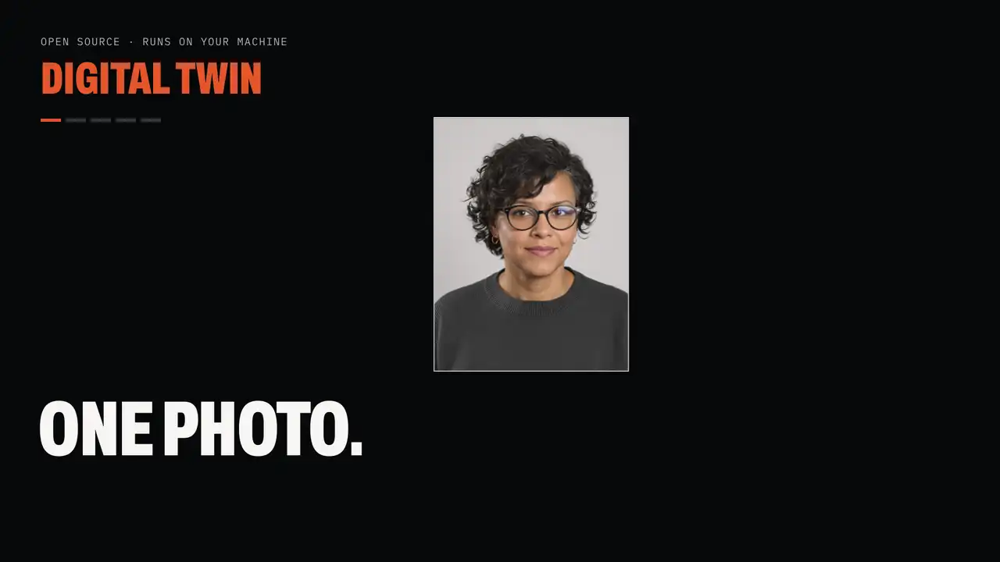
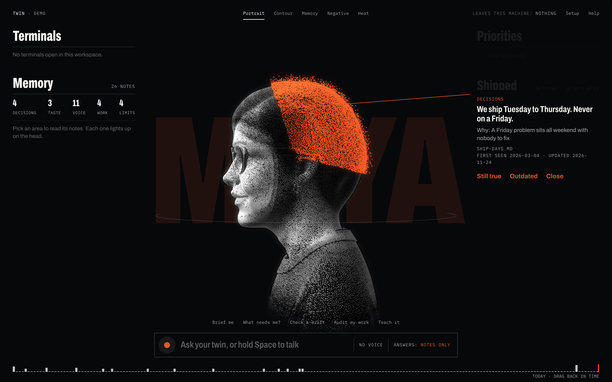
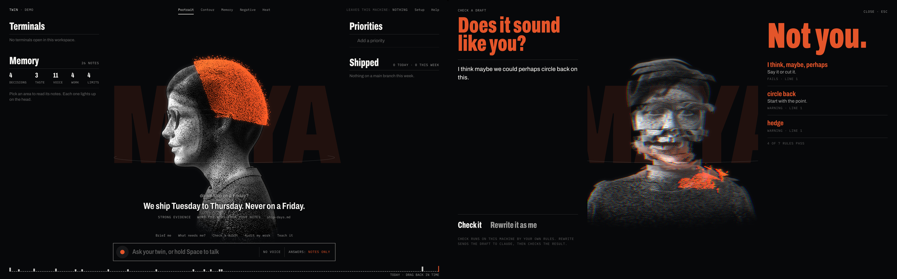
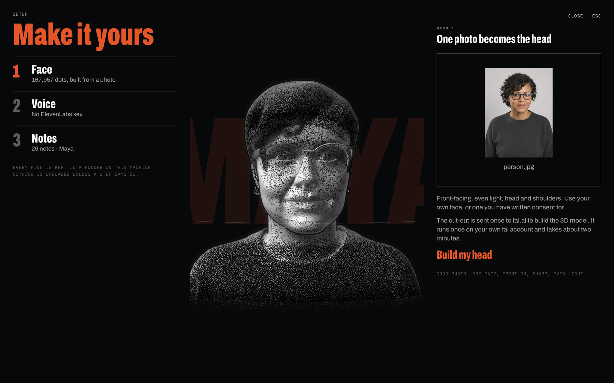

# Digital Twin of Yourself（你自己的数字分身）

[English](README.md) · **简体中文**

**一个了解你工作的数字分身。**

把你的决定、语气规则和底线放在一个地方，让你的编程会话随时可以来问。它运行在你自己的电脑上。你保存笔记文件夹后，选中的笔记才会被读入。会话可以提议新笔记，但要等你审核通过后才会进入记忆。

适合已经在用编程智能体、又厌倦了同一件事要纠正两遍的人。

**4.0 新增：** 分身应用、用你的照片生成的头像、声音，以及给编程会话用的 MCP 服务器。[在 whystrohm.com/twin 查看](https://whystrohm.com/twin?utm_source=github&utm_medium=repo&utm_campaign=twin-4-zh) · [使用指南（英文）](docs/TWIN.md) · [更新日志（英文）](CHANGELOG.md)



*演示里的人物是虚构的：生成的人脸和编造的笔记。画面中的仓库数量和回答只是示例。*



## 做一个你自己的分身

演示用的是虚构人物。真正有意思的是做你自己的，看看会得到什么。

- **你的脸。** 拖入一张照片，得到一个由点组成、可以三百六十度转动的 3D 头像。
- **你的声音。** 录一分钟，在你自己的 ElevenLabs 账号上克隆。分身会用你自己的声音把你自己的决定念给你听。第一次听有点诡异，但这也是判断一句话像不像你的最快办法。
- **你的思路。** 每一个点就是一条笔记：一个决定、一种偏好、一条语气规则或一条底线，附带原因和日期。把鼠标移到头像上，看到的就是你的工作方式，白纸黑字。
- **你的代码。** 列出你的仓库，它会读取其中的指令文件，并把找到的规则作为提议交给你。你能看到编程工具被告知了哪些关于你的事，又漏掉了哪些。

你自己写的文字是最可靠的来源。别人的范例无法告诉模型你是怎么说话的。本仓库里的[语气工具（英文）](docs/VOICE-TOOLS.md)会测量你的写作习惯，把它变成检查器可以执行的规则，这样草稿、帖子和营销文案出来的是你的语言，而不是千篇一律的腔调。

随便玩。问它你上个月做了什么决定。贴一段草稿，看它不通过。改变主意，看旧笔记被替换。请只使用你自己的脸和声音，或已获得书面同意的人的。

## 为什么需要它

| 问题 | 分身怎么做 |
|---|---|
| 你的纠正留不住。在这个会话里改过，换个工具又得再改一遍。 | 把每个决定存成一个纯文本文件，带来源和日期。任何支持 MCP 的会话都可以来查。 |
| 指令文件会走样。没人知道哪条规则是最新的，也不知道它从哪来。 | 新决定可以替换旧决定。旧的会保留，标记为已替换，还可以恢复。 |
| AI 写的草稿不像你。 | 按你的规则检查草稿（最长 60,000 字符），并指出每一行不通过的地方。 |
| 智能体不打招呼就动手。 | 报告命中的底线，对它识别出的受限操作请求你确认。它给的是建议，无法阻止其他工具执行操作。 |
| 你开的会话多到看不过来。 | 显示已发布和接下来要做的事；如果你打开该选项，还会显示进行中的会话。 |

## 一分钟试用

分身应用需要 macOS 或 Linux、Python 3.9 或更高版本。不支持原生 Windows。Linux 和 WSL 未在本次发布审计中验证。演示不需要额外安装包，也不需要任何账号。

```bash
git clone https://github.com/whystrohm/digital-twin-of-yourself.git
cd digital-twin-of-yourself
python3 twin/twin.py
```

它会在浏览器里打开演示分身。界面是英文的。然后试试：

- 把鼠标移到头像上。每个点对应一条笔记。
- 输入 `do we ship on a Friday?`，它会根据笔记回答，并显示来自哪一条。
- 输入 `send the supplier email`，它会停下来等你确认。
- 点击 **Check a draft**，贴一段带有 "I think maybe" 的文字。在你到 Setup 里设置自己的规则之前，它用的是示例规则。
- 把底部的时间条往回拖。



## 变成你自己的

点击 **Setup**。共三步，每一步都可以跳过。

| 步骤 | 会发生什么 | 需要什么 |
|---|---|---|
| **脸（Face）** | 拖入一张照片。它先检查照片并告诉你要改什么，然后生成一个可以完整转动的 3D 头像。 | 一个 fal 密钥和几个 Python 包。在你自己的账号上付费生成一次。 |
| **声音（Voice）** | 选择免费的系统语音、一个 ElevenLabs 语音，或者录一分钟克隆你自己的声音。 | 系统语音什么都不需要。其余需要 ElevenLabs 密钥。 |
| **笔记（Notes）** | 选择它可以读取的笔记文件夹和仓库。保存后才会读入。仓库里的规则会变成提议等你审核。规则文件和语气档案也在这里选择。 | 一个 Markdown 笔记文件夹。Claude Code 的记忆文件夹可以直接用。只使用你有权使用的材料。 |



完整说明见 [docs/TWIN.md](docs/TWIN.md)（英文）。

## 接入你的编程会话

分身同时也是一个 MCP 服务器。任何支持 MCP 的工具都可以在瞎猜之前先问它，并在你纠正它时提议一条笔记。会话不能批准自己的提议，每一条都由你在页面里接受或丢弃。

```bash
claude mcp add twin -- python3 /full/path/to/twin/twin_mcp.py
```

| 会话问 | 分身答 |
|---|---|
| 这个操作允许吗？ | 命中的底线，或请求你确认。没有命中时，权限状态为未知。 |
| 检查这份草稿 | 每条规则通过或不通过，并给出不通过的原文。 |
| 我们当时怎么决定的？ | 笔记摘要，附来源、适用范围和证据等级。 |
| 审计我的工作 | 只读：未推送、未提交、语气不符、已跟踪文件里疑似密钥。 |

## 什么会离开你的电脑

默认的打字演示在你拿到仓库之后，不会向外发送任何东西。下面是每个可选功能发送的内容和去向。

| 你打开了 | 发出去的内容 | 去哪里 |
|---|---|---|
| 什么都不开（默认） | 无 | 无 |
| 由 Claude 回答 | 你的问题、显示名称、匹配到的笔记（含来源和摘录）、优先事项、仓库和已发布列表、语气档案 | Claude，通过你自己的 CLI |
| 用我的语气改写 | 草稿、规则和语气档案。重试时会附上未通过规则的反馈 | Claude，通过你自己的 CLI |
| 已连接的 MCP 客户端 | 它请求的笔记文本、来源、规则结果或工作摘要 | 通过本地 stdio 发给调用方，适用其服务商的政策 |
| ElevenLabs 语音 | 未命中缓存时的回复或试听文本。系统语音不发送任何内容 | ElevenLabs，通过你自己的密钥 |
| 语音列表 | 一次带认证的请求，获取你账号下可用的语音 | ElevenLabs，通过你自己的密钥 |
| 克隆声音 | 录音、你起的名字和描述 | ElevenLabs，通过你自己的密钥 |
| 生成头像 | 每次生成时抠好图的照片 | fal，通过你自己的密钥 |
| 照片检查 | 缺少人脸检测模型时会下载一次。照片本身在本地检查 | GitHub 上的 OpenCV Zoo |
| 生成头像所需的模型下载 | 缺少抠图模型权重时的一次下载请求 | rembg 使用的模型托管方 |

会话发现默认关闭。打开后，它会读取本机 Claude Code 会话的元数据和记录末尾，包括标题、最近的提示、工作目录、状态和时间。完整的读取与存储说明见 [docs/TWIN.md](docs/TWIN.md)（英文）。

## 使用须知

- 只使用你自己的脸和声音，或已获得书面同意的人的。别人的分身属于那个人。
- 只使用你有权使用的文字。公司材料需要获得批准，并先去掉客户、同事和保密信息。
- Setup 会记录你对照片和声音的自我声明。它无法核实身份或书面许可。
- 不要用它来监视或评价任何人。

完整清单见 [SAFETY_CHECKLIST.md](SAFETY_CHECKLIST.md)（英文）。

## 语气工具

**看清你实际是怎么写的，然后用它检查每一份草稿，不管是你写的还是 AI 写的。** 分身的语气规则就来自这些工具，它们也可以单独使用。完整指南见 [docs/VOICE-TOOLS.md](docs/VOICE-TOOLS.md)（英文）。

## 搭配 Shotkit

[Shotkit](https://github.com/whystrohm/shotkit) 在 Claude Code 里规划并检查符合品牌的视频，并且有[中文说明](https://github.com/whystrohm/shotkit/blob/main/README.zh-CN.md)。分身保存你的偏好和底线。把两者接到同一个 Claude Code 会话里，它就可以在规划镜头前先问分身你喜欢什么。Shotkit 目前还不会主动调用分身。

## 许可

MIT。免费开源。由 [WhyStrohm](https://whystrohm.com) 制作。

*本页是英文 README 的中文版。两者有出入时，以[英文版](README.md)为准。*
